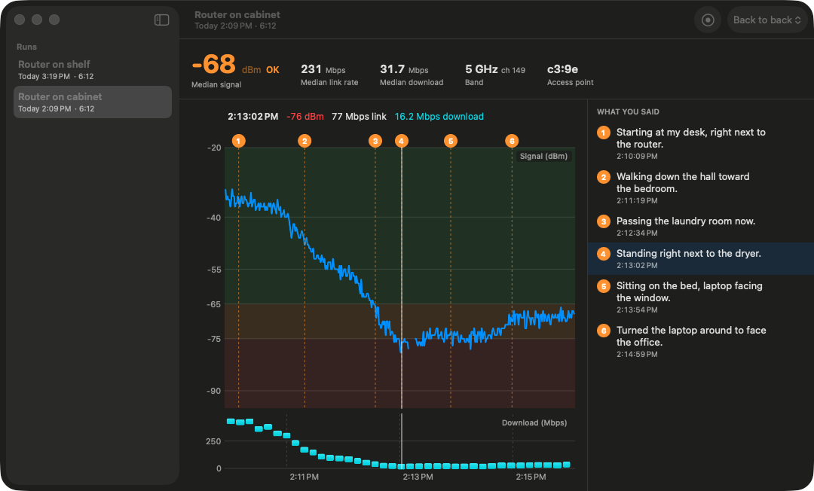

# WhyFi

Find out why your Wi-Fi drops. Carry your Mac around, say where you are and what you're doing, and WhyFi lines up what you said with the Wi-Fi signal and download speed at that moment.



*The screenshot shows a sample walk.*

## Why

I moved my router a few feet into a corner and my bedroom Wi-Fi got noticeably slower. A signal meter told me *that* it dropped, not *why*. Was it the washer and dryer in the way, the direction the laptop was facing, or the Mac hopping to a different access point?

WhyFi records the Wi-Fi measurements and your narration on one timeline. A drop at 2:13:02 lines up with "Standing right next to the dryer." Record a walk, change something (raise the router, add a mesh point), record the same walk again, and compare.

## What it records

- **Signal, every second:** strength (RSSI) and noise in dBm, the link rate, channel, band and channel width, and which access point you're on.
- **Download speed tests, one after another,** using Apple's built-in `networkQuality`. They're bound to the Wi-Fi interface, so they measure Wi-Fi even when the Mac is docked on Ethernet.
- **Your narration,** transcribed on your Mac by Apple's speech recognition. Each sentence becomes a numbered pin on the chart.

Audio and transcripts never leave your Mac. The only network traffic is the speed tests themselves.

## Requirements

- macOS 26 or later (Apple's on-device transcriber needs it)
- Xcode 27 to build

## Build and run

```bash
git clone https://github.com/timfurlong/whyfi.git
cd whyfi
open WhyFi.xcodeproj
```

Then press Run. The project signs with "Sign to Run Locally", so you don't need an Apple developer account. macOS may ask for permissions again after you rebuild. To stop that, pick your own team under Signing & Capabilities.

## Permissions

- **Microphone,** to hear your narration. Without it, WhyFi still records the Wi-Fi.
- **Location.** macOS only tells apps which access point you're connected to if they have Location access. WhyFi uses it to show when your Mac switches between a router and a mesh point. It never reads your location. Without it, everything else still works.
- The first run downloads Apple's English speech model, which macOS manages.

## Using it

1. Click **New Run** (⌘N), name it after what you're testing ("Router on shelf"), and click **Record**.
2. Walk around. Say where you are and anything that might matter: "In the hall," "Laptop facing the wall," "Next to the fridge."
3. Click **Stop** (⌘.).

To compare two setups, walk the same route in the same order each time, and stay about 30 seconds at each spot so a few speed tests finish there.

### Speed tests and data use

Back-to-back speed tests download about 1.5 GB a minute. If your plan has a data cap, switch to **Every 30 seconds** or **Off** in the toolbar or in Settings. Signal is recorded either way.

## Run files

Each run is a folder in `~/Library/Application Support/WhyFi/Runs/`. Right-click a run and choose **Show in Finder**.

| File | What's in it |
|---|---|
| `timeline.csv` | Every signal reading, speed test, sentence and event, one row each |
| `transcript.txt` | Your sentences, one per line: `[14:02:14] Standing next to the dryer.` |
| `run.json` | The run's name, start and end times, Mac and macOS version, speed test setting, and which permissions were granted |
| `audio.m4a` | Your narration. A run that ended in a crash keeps `audio.caf` instead |

`timeline.csv` columns: `time, elapsed_s, kind, rssi_dbm, noise_dbm, tx_rate_mbps, channel, band, width_mhz, bssid, download_mbps, responsiveness_rpm, text, end_time`.

- `kind` is `signal`, `speed`, `speech` or `event`.
- For `speed` and `speech` rows, `time` is when the test or sentence started and `end_time` when it ended. A speed row's `rssi_dbm` and `tx_rate_mbps` are averages over the test.
- Events include `run_started`, `run_stopped`, `wifi_disconnected`, `wifi_reconnected`, `access_point_changed <old> -> <new>`, `band_changed <old> -> <new>`, `speed_test_failed: <reason>`, `speech_unavailable: <reason>` and `location_denied`.
- Sentences are written a moment after you say them, so the file isn't strictly in time order. Sort by `time`.

## Analyze your runs with Claude

WhyFi records and shows. For the comparing, point an AI assistant like [Claude Code](https://claude.com/claude-code) at two run folders:

> Compare these two runs of the same walk. Where did the signal and speed drop, what was I describing at the time, and did moving the router help?

Your narration is what lets it line up places across runs, so say where you are.

## Development

- `scripts/test` runs the unit tests.
- `TEST_RUNNER_WHYFI_HARDWARE_TESTS=1 scripts/test` also runs the tests that need this Mac's Wi-Fi and speech recognition.
- The Xcode project is generated by [XcodeGen](https://github.com/yonaskolb/XcodeGen) from `project.yml`. Run `xcodegen generate` after adding or removing files.
- Set `WHYFI_RUNS_ROOT` to point the app at a different runs folder.

## Credits

The live transcription follows the approach in [Muesli](https://github.com/Muesli-HQ/muesli), and `TranscriptAccumulator.swift` is adapted from its code (MIT). See [NOTICE](NOTICE).

## License

MIT. See [LICENSE](LICENSE).
